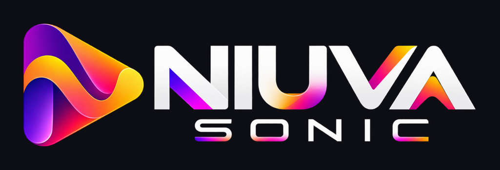

<div align="center">



### A New World of Sound.

A modern desktop client for your own music collection, built for [Navidrome](https://www.navidrome.org/) and the Subsonic API.<br>
No subscription. No ads. No third-party cloud. Just your library.

[](https://github.com/foxy221/niuva-sonic/releases/latest)
[](https://github.com/foxy221/niuva-sonic/actions/workflows/ci.yml)
[](LICENSE)


[**Download**](https://github.com/foxy221/niuva-sonic/releases/latest) · [Features](#features) · [Install](#install) · [Build from source](#build-from-source) · [Roadmap](#roadmap) · [Contributing](#contributing)

</div>

---

## About

Niuva Sonic plays the music on **your own server**. Connect it to a Navidrome instance (or any Subsonic-compatible server) and get a fast, clean and good-looking interface for your library: browse, search, queue, download for offline listening, and keep your favourites and playlists in sync with the server.

The app is a small native Windows program (a few megabytes, built with [Tauri](https://tauri.app/) and Rust), not a bundled browser. Your password is never stored.

> **Status:** Niuva Sonic is in active development (0.x). It is stable enough for daily use on Windows and is tested against Navidrome. The interface is available in **English** (default) and **German**; switch under *Settings → Language*.

## Features

**Interface**
- English and German, switchable at any time in the settings (fresh installs start in English)

**Library**
- Browse artists, albums, genres and playlists, with sorting and paging
- Search across your whole collection, grouped by artists, albums and tracks
- Favourites for tracks, albums and artists
- Create, rename, reorder and delete playlists; add single tracks or whole albums

**Playback**
- Queue with drag-and-drop reordering, "play next", append, shuffle and repeat
- Gapless playback and preloading of the next track
- Adjustable streaming quality (format and bitrate) and ReplayGain
- Scrobbling to your server and a queue that survives restarts
- Full-screen player with an audio-reactive background that follows the cover art

**Offline**
- Download albums and tracks for listening without a connection
- Offline library with cover art and storage management (size limit, clean-up)

**Windows integration**
- Tray icon with playback controls; closing the window can minimise to the tray
- Media keys and the Windows media overlay (title, artist and cover)
- Remembers window size and position; a second launch focuses the running window
- Per-user installer that needs no administrator rights
- **Automatic updates:** signed packages, verified before they are installed

**Privacy and security**
- Your password is never saved; sign-in uses the Subsonic token and salt
- Token and salt are stored in the **Windows Credential Manager**, not in a file
- The app only talks to the server you enter
- Multiple server profiles, each with its own credentials
- Diagnostics view with connection check, reported server capabilities and a log file

## Install

1. Download `Niuva.Sonic_<version>_x64-setup.exe` from the [latest release](https://github.com/foxy221/niuva-sonic/releases/latest).
2. Run the installer. It installs for your user account and does not need administrator rights; the app appears in the Start menu.
3. Windows SmartScreen may show *"Windows protected your PC"* because the installer is **not yet code-signed**. Choose **More info → Run anyway**.
4. On first start, enter your server address, user name and password.

**Requirements:** Windows 10 or 11 (64-bit) with WebView2 (included in Windows 11), and a reachable Navidrome or Subsonic server.

**Updating:** *Settings → Windows → Updates → Check for updates*. The app downloads the new version, verifies its signature and installs it after you click *Install and restart*. Updates only come from the GitHub releases of this project and are signed with the project's own key.

**Uninstalling:** *Settings → Apps → Installed apps → Niuva Sonic*. Server profiles and your sign-in are kept in case you reinstall. To remove everything, delete the profiles inside the app first, then delete `%APPDATA%\de.niuva.sonic`.

### Known limitations

- **No Authenticode signature yet.** SmartScreen warns when you run a downloaded installer. In-app updates are not affected; they are verified with the project's own signing key.
- **Media overlay name.** Windows shows the app as "Unknown application" in the media overlay, because of how WebView2 reports itself. Title, artist and cover are correct.
- **Windows only** (64-bit) for now.
- **Signing out** ends the session but keeps the server profile and its stored credentials. Remove the profile in the settings to forget it.
- Tested with Navidrome. Other Subsonic servers work, but report fewer OpenSubsonic extensions (for example, no ReplayGain values).

## Build from source

Prerequisites: [Node.js](https://nodejs.org/) 24, [pnpm](https://pnpm.io/), [Rust](https://www.rust-lang.org/tools/install) (MSVC toolchain) and WebView2.

```bash
pnpm install
pnpm tauri dev      # development mode with hot reload
pnpm typecheck      # TypeScript, no output
pnpm test           # frontend tests (Vitest)
cargo test          # Rust tests, run inside src-tauri/
pnpm e2e            # end-to-end run against your own server (read-only)
pnpm tauri build    # release build, installer in src-tauri/target/release/bundle/nsis
```

`pnpm e2e` reads a `zugangsdaten.txt` next to the project with the server address, user name and password, one per line. It checks sign-in, the library, an album and playing a track, and never changes data on the server.

A release build with update artifacts also needs the signing key in the `TAURI_SIGNING_PRIVATE_KEY` environment variable (see `src-tauri/tauri.conf.json`). Without it, `pnpm tauri build` still produces the installer but fails at the signature step.

## Tech stack

| Area | Choice |
| --- | --- |
| App shell | [Tauri 2](https://tauri.app/) (Rust) |
| UI | React 19, TypeScript, Vite |
| Server data | TanStack Query |
| App state | Zustand |
| Routing | React Router |
| Networking | `tauri-plugin-http` (runs on the Rust side, so no CORS issues with your server) |
| Storage | `tauri-plugin-store`; credentials in the Windows Credential Manager via `keyring` |
| Tests | Vitest, `cargo test`, end-to-end run against a test server |
| CI | GitHub Actions: type check, tests, Windows build; tag-triggered release workflow |

```
src/api/          Subsonic client and types
src/hooks/        Data access through TanStack Query
src/state/        Stores: session, player, settings, offline, profiles, capabilities
src/components/   Building blocks and app frame
src/screens/      Views (library, player, settings, diagnostics, ...)
src/design/       Tokens, colour extraction, visualizer helpers
src-tauri/        Rust shell: tray, window, media keys, updater, keychain, log file
scripts/          End-to-end run
branding/         Logos
```

## Roadmap

The goal is **version 1.0.0**: a fully finished Windows app. The main steps:

- **Visualizer polish:** calmer clouds whose colours follow the cover art.
- **Interface:** top bar with search and profile, playlist mosaic covers, page transitions, a progress bar with hover preview.
- **Features:** synchronised lyrics, adding a server profile without signing out, more keyboard shortcuts.
- **Release quality:** Authenticode code signing, a changelog, screenshots.

Ideas being evaluated: equaliser and crossfade, sleep timer, filtering the library by format and bitrate, mixes built from your own library, resuming playback across devices, radio and podcasts. Android and other desktop platforms come after 1.0.0.

## How it is made

Transparency matters, so here is who did what:

- **The idea and the name** of Niuva Sonic are purely human. The origin of the name is explained in [docs/Name-und-Bedeutung.md](docs/Name-und-Bedeutung.md) (German).
- **The code** is written by a human with AI assistance. Concept, decisions and review are human; the AI helps with writing and reviewing code.
- **The logos** were created with generative AI and then reworked by hand.

## Contributing

Bug reports, wishes and ideas are welcome: please open an [issue](https://github.com/foxy221/niuva-sonic/issues). For connection problems, include your Windows version, the app version (*Settings → Windows → Updates*) and the version of your server. The diagnostics view (*Settings → Open diagnostics*) shows the log file location and the capabilities your server reports.

Before sending a pull request, run `pnpm typecheck`, `pnpm test` and `cargo test`; the CI runs the same checks.

## License

The source code is licensed under the [Apache License 2.0](LICENSE). The name, logos and mark "Niuva Sonic" are excluded and may not be used for other projects without permission.

Niuva Sonic is an independent project and is not affiliated with Navidrome or the Subsonic project.
